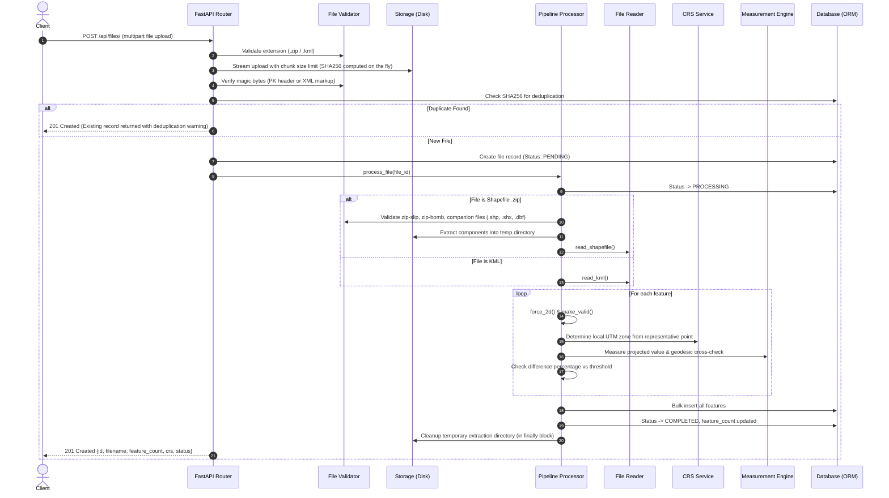
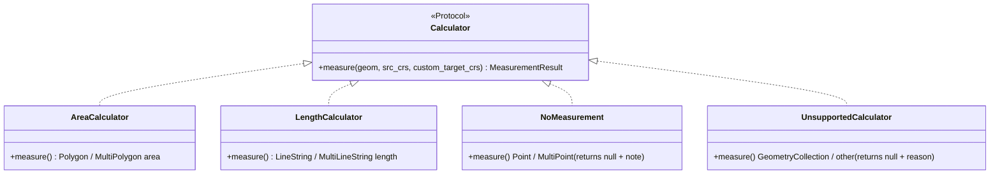

# Geospatial File Measurement API: Architecture & Technical Design

## 1. Overview

The **Geospatial File Measurement API** is a high-precision backend service engineered to ingest geospatial vector files (ESRI Shapefiles archived in `.zip` format and OGC Keyhole Markup Language `.kml`), extract individual vector features, calculate accurate real-world measurements (planar area in square metres for polygons, geodesic length in metres for linestrings), persist the results, and expose them through a clean REST API.

### Core Architectural Principle
> **Never compute surface area or line distance directly on geographic coordinate degrees (Latitude / Longitude).** 
> 
> Degrees represent spherical angular coordinates whose linear physical ground distances vary significantly with latitude (e.g., $1^\circ$ longitude equals $\approx 111.32\text{ km}$ at the equator, but shrinks to $0\text{ km}$ at the poles). 
> All geometries must be reprojected into a suitable metric projected Coordinate Reference System (CRS) using `always_xy=True` and cross-verified against an ellipsoidal geodesic calculation on the WGS84 ellipsoid.

---

## 2. High-Level Architecture

The service follows a layered architecture with strict separation between HTTP delivery, business logic, persistence, and storage.

```mermaid
flowchart TD
    Client([Client / Frontend]) -->|HTTP Requests| API[API Layer: FastAPI Routes & Pydantic Schemas]
    
    subgraph Services [Domain & Geospatial Services (HTTP-Agnostic)]
        Validator[File Validator: Extensions, Magic Bytes, Zip-Slip, Bomb Caps]
        Processor[Processor: Pipeline Orchestrator]
        Reader[File Reader: Pyogrio & Shapely 2.x]
        CRS[CRS Service: Local UTM Zone & Reprojection]
        MeasEngine[Measurement Engine: Strategy Pattern & pyproj.Geod]
        GeomUtils[Geometry Utilities: force_2d & make_valid]
    end

    subgraph Persistence [Data & Storage Layer]
        FileRepo[File Repository]
        FeatureRepo[Feature Repository]
        DB[(Database: SQLite / PostgreSQL)]
        Disk[(Isolated Disk Storage: uploads/uuid/)]
    end

    API --> Validator
    API --> Processor
    API --> FileRepo
    API --> FeatureRepo

    Processor --> Validator
    Processor --> Reader
    Processor --> CRS
    Processor --> MeasEngine
    Processor --> GeomUtils
    Processor --> FileRepo
    Processor --> FeatureRepo

    Reader --> Disk
    FileRepo --> DB
    FeatureRepo --> DB
```

### Layer Responsibilities

| Layer | Responsibility | HTTP Knowledge |
|---|---|---|
| **API (`app/api/`)** | Request parsing, query parameter validation, response serialization, status codes, uniform error formatting. | Yes |
| **Services (`app/services/`)** | Geospatial extraction, CRS transformations, metric calculations, geometry repair, safety validation. | No |
| **Repositories (`app/repositories/`)** | Database queries, transactional commits, bulk record insertions. | No |
| **Models (`app/models/`)** | SQLAlchemy 2.0 ORM schema definitions. | No |
| **Core (`app/core/`)** | Domain exceptions, structured logging with correlation IDs. | No |

---

## 3. Request Lifecycle & Processing Pipeline



---

## 4. Measurement Engine & Strategy Pattern

The measurement engine is built around the **Strategy Pattern** to support open-closed extensibility without large conditionals:

```python
class Calculator(Protocol):
    def measure(self, geom: BaseGeometry, src_crs: str, custom_target_crs: Optional[str] = None) -> MeasurementResult: ...
```



### 4.1 Per-Feature UTM Zone Selection
For geographic CRS inputs (e.g., `EPSG:4326`), a representative point on the feature is selected, and its appropriate UTM zone is determined algorithmically:

$$\text{zone} = \min\left(\left\lfloor \frac{\text{longitude} + 180}{6} \right\rfloor + 1, 60\right)$$

$$\text{EPSG} = \begin{cases} 
32600 + \text{zone} & \text{if } \text{latitude} \ge 0 \quad (\text{North}) \\
32700 + \text{zone} & \text{if } \text{latitude} < 0 \quad (\text{South})
\end{cases}$$

### 4.2 Reprojection Rules
1. **Source is Geographic (`EPSG:4326`)**: Selected local UTM zone is used. `always_xy=True` is strictly passed to prevent axis inversion errors.
2. **Source is Projected Metric (`EPSG:32643`, `EPSG:3857`, etc.)**: If axis units are metres, source coordinates are used directly without double-reprojection.
3. **Source is Projected Non-Metric (`EPSG:2227` - US Survey Feet)**: Units are identified, and the feature is reprojected to local metric UTM.

### 4.3 Geodesic Cross-Check & Dual-Method Validation
Planar UTM projections introduce scale distortions, particularly for features spanning multiple UTM zones or situated far from the zone's central meridian. To ensure mathematical accuracy:

1. The geometry is evaluated on the WGS84 reference ellipsoid using `pyproj.Geod(ellps="WGS84")`:
   - For Polygons: `abs(geod.geometry_area_perimeter(geom)[0])`
   - For LineStrings: `abs(geod.geometry_length(geom))`
2. The percentage difference is calculated:
   $$\text{difference\_pct} = \frac{|\text{projected} - \text{geodesic}|}{\text{geodesic}} \times 100$$
3. If $\text{difference\_pct} > \text{DIFF\_THRESHOLD\_PCT}$ (default $0.5\%$), the geodesic value is automatically adopted as the primary `measurement_value`, the method is tagged as `geodesic`, and an explicit warning is attached to the feature.

---

## 5. Security & Robustness

1. **Zip-Slip Protection**: Member paths in `.zip` archives are inspected prior to extraction. Any entry containing absolute paths or parent directory traversal sequences (`..`) is aborted with HTTP 400.
2. **Zip-Bomb Protection**:
   - Total archive entry count is bounded (default maximum: 500 entries).
   - Total uncompressed byte size across all entries is bounded (default maximum: 200 MB).
3. **XXE Injection Guard**: KML documents are parsed safely through `defusedxml` to prevent XML entity expansion and external entity retrieval attacks.
4. **Streaming File Upload**: File uploads are streamed into disk buffers in $64\text{ KB}$ chunks while checking cumulative size to avoid memory exhaustion attacks.
5. **Path Randomization**: Files are stored in UUID-keyed directory structures (`uploads/<uuid>/original_<name>`), completely isolated from client control.
6. **Graceful Feature Degradation**: An invalid or corrupt individual feature is repaired using `shapely.make_valid()`; if unrepairable, it is flagged with a warning rather than causing the entire batch to fail.
